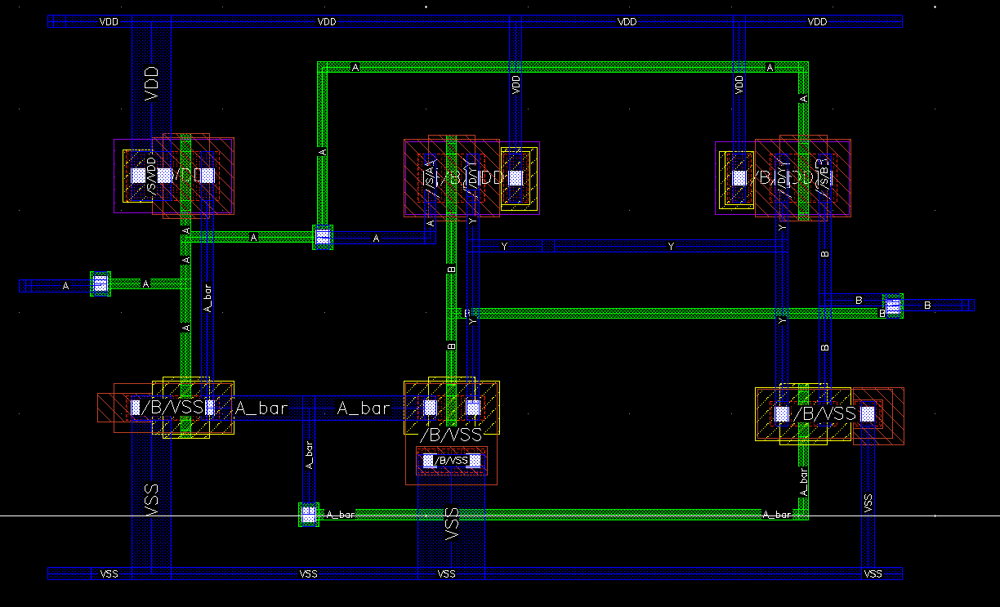

# 4-Bit Parity Generator and Checker Using Transmission Gate Logic

## 1. Project Overview

This project focuses on the design and implementation of a **4-Bit Parity Generator and Checker using CMOS Transmission Gate Logic**.

The main objective is to design a digital circuit that generates an even parity bit for 4-bit input data and checks the received data for parity errors.

The complete circuit is designed at the transistor level using NMOS and PMOS transistors in **Cadence Virtuoso IC 6.1.8** with the GPDK 90 nm technology library.

The project includes transistor-level schematic design, XOR gate implementation, transient simulation, physical layout design, and DRC/LVS verification.

---

## 2. Project Objectives

- Design a 4-bit even parity generator.
- Design a parity checker for detecting transmission errors.
- Implement XOR gates using CMOS transmission gate logic.
- Develop transistor-level schematics in Cadence Virtuoso.
- Perform transient analysis to verify circuit functionality.
- Design the physical layout of the complete circuit.
- Perform Design Rule Check (DRC).
- Perform Layout Versus Schematic (LVS) verification.

---

## 3. Software and Technology Used

| Parameter | Description |
|---|---|
| EDA Tool | Cadence Virtuoso |
| Version | IC 6.1.8 |
| Technology Library | GPDK 90 nm |
| Design Type | Full Custom VLSI Design |
| Logic Style | CMOS Transmission Gate Logic |
| Simulation | Transient Analysis |
| Verification | DRC and LVS |

---

## 4. Working Principle

### 4.1 Parity Generator

The parity generator accepts four input bits:

- A
- B
- C
- D

It generates an additional parity bit to make the total number of 1s even.

The Boolean expression for even parity generation is:

**P_GEN = A XOR B XOR C XOR D**

Where:
- P_GEN = Generated parity bit.
- XOR = Exclusive OR operation.

### 4.2 Parity Checker

The parity checker compares the generated parity bit with the received parity bit.

The Boolean expression is:

**ERROR = P_GEN XOR P_RX**

Where:
- P_GEN = Generated parity bit.
- P_RX = Received parity bit.
- ERROR = Error detection output.

| P_GEN | P_RX | ERROR | Result |
|---|---|---|---|
| 0 | 0 | 0 | No parity mismatch |
| 0 | 1 | 1 | Error detected |
| 1 | 0 | 1 | Error detected |
| 1 | 1 | 0 | No parity mismatch |

**Note:** Parity checking detects an odd number of bit errors but cannot detect every possible multiple-bit error.

---

## 5. Block Diagram

The complete circuit consists of two main sections:

1. 4-Bit Parity Generator.
2. Parity Checker.

The design uses four cascaded XOR stages.

---

## 6. Transmission Gate XOR Implementation

The XOR gates are implemented using CMOS transmission gate logic.

A CMOS transmission gate consists of:

- One NMOS transistor.
- One PMOS transistor.

Both transistors are connected in parallel and controlled by complementary signals.

The transmission gate allows both logic HIGH and logic LOW signals to pass effectively.

The XOR function is implemented using transmission gates and CMOS inverters.

### XOR Truth Table

| A | B | Y |
|---|---|---|
| 0 | 0 | 0 |
| 0 | 1 | 1 |
| 1 | 0 | 1 |
| 1 | 1 | 0 |

---

## 7. XOR Gate Schematic

The XOR gate was designed at transistor level using CMOS transmission gate logic in Cadence Virtuoso.

The implementation consists of NMOS and PMOS transistors configured to perform the XOR operation.


---

## 8. XOR Gate Layout

The physical layout of the XOR gate was created using Cadence Virtuoso Layout Editor.

The layout contains the required transistor structures and interconnections based on the schematic design.



---

## 9. Complete Parity Generator and Checker Schematic

The complete circuit was constructed by cascading four transmission-gate-based XOR stages.

The first three XOR gates generate the even parity bit, while the fourth XOR gate performs parity checking.


---

## 10. Testbench Design

A separate testbench was created to verify the functionality of the complete parity generator and checker circuit.

The testbench provides input combinations to the circuit and allows observation of the generated parity and error detection outputs.


---

## 11. Transient Simulation Results

Transient analysis was performed in Cadence Virtuoso to verify the functionality of the circuit.

The simulation waveforms are used to observe the input signals, generated parity output, and error detection output.

The expected operation is:

- ERROR = 0 when the generated and received parity bits match.
- ERROR = 1 when the generated and received parity bits differ.


---

## 12. Complete Physical Layout

The complete physical layout of the 4-bit parity generator and checker was developed using the individual XOR gate implementation.

The layout represents the complete circuit connectivity, including the generator and checker sections.


---

## 13. Design Rule Check (DRC)

Design Rule Check (DRC) was performed to verify that the physical layout follows the manufacturing design rules of the selected technology library.

DRC checks include:

- Minimum spacing requirements.
- Minimum width requirements.
- Contact and via rules.
- Metal routing rules.
- Well and diffusion design rules.


---

## 14. Layout Versus Schematic (LVS)

Layout Versus Schematic (LVS) verification was performed to compare the physical layout with the corresponding schematic.

It checks whether the layout correctly represents the electrical connections and components of the schematic.

The LVS debugging screenshots are included below for reference.

### LVS Debug Screenshot 1


### LVS Debug Screenshot 2


---

## 15. Simulation and Physical Design Results

### 15.1 Transient waveform calculations

The Cadence transient waveform in the repository spans approximately 0–400 ns. The input channels use square-wave stimuli with approximately 50% duty cycle.

| Waveform channel | Approx. period | Calculated stimulus frequency |
|---|---:|---:|
| A0 | 20 ns | 50 MHz |
| B0 | 40 ns | 25 MHz |
| B1 | 80 ns | 12.5 MHz |
| B2 | 160 ns | 6.25 MHz |
| B3 | 320 ns | 3.125 MHz |

Frequency is calculated using:

`f = 1/T`

For example, for A0:

`f_A0 = 1/(20 ns) = 50 MHz`

The displayed transient simulation window is approximately **400 ns**. These frequencies describe the applied testbench input patterns.

### 15.2 Transistor dimensions

The NMOS and PMOS property windows in the supplied Cadence screenshots show the following device dimensions:

| Device | Channel length (L) | Total width (W) | Fingers | W/L ratio |
|---|---:|---:|---:|---:|
| NMOS | 100 nm | 120 nm | 1 | 1.2 |
| PMOS | 100 nm | 120 nm | 1 | 1.2 |

Calculation:

`W/L = 120 nm / 100 nm = 1.2`

### 15.3 Layout verification

The Cadence DRC result dialog reports **“No DRC errors found”**, corresponding to zero reported DRC violations in the displayed run.

The LVS debug screenshots report **“Schematic and Layout Match”**. The comparison summary shown in the screenshot also reports zero net, device, pin, and parameter mismatches.

| Verification item | Result |
|---|---:|
| DRC errors | 0 |
| LVS status | Schematic and layout match |
| LVS net mismatches | 0 |
| LVS device mismatches | 0 |
| LVS pin mismatches | 0 |
| LVS parameter mismatches | 0 |

### 15.4 Simulation evidence

The repository includes the transient response of the parity generator and checker, showing the input channels and the generated parity and check outputs over the 400 ns test interval. The supplied Cadence screenshots also document the completed physical layout and the DRC/LVS verification results.

## 16. Applications

- Digital communication systems.
- Data transmission error detection.
- Memory error detection circuits.
- Digital electronic systems.
- VLSI digital circuit design.

---

## 17. Conclusion

The 4-Bit Parity Generator and Checker was designed using CMOS Transmission Gate Logic in Cadence Virtuoso.

The project demonstrates the implementation of XOR-based parity generation and error detection at the transistor level.

The project also provides practical experience in full-custom VLSI design, schematic development, transient simulation, physical layout implementation, and DRC/LVS verification.

---

## 18. Repository Structure

```text
4-Bit-Parity-Generator-and-Checker/
│
├── README.md
│
└── Images/
    ├── DRC Check.jpg
    ├── LVS debug.jpg
    ├── LVS debug_1.jpg
    ├── Parity generator and checker waveform.jpg
    ├── Parity generator&checker TB.jpg
    ├── XOR GATE Schematic.jpg
    ├── XOR_LAYOUT.png
    ├── parity generator & checker schematic.jpg
    └── partity generator&checker layout.jpg
```

---

**Project Title:** 4-Bit Parity Generator and Checker Using Transmission Gate Logic

**EDA Tool:** Cadence Virtuoso IC 6.1.8

**Technology:** GPDK 90 nm

**Domain:** VLSI – Digital IC Design
